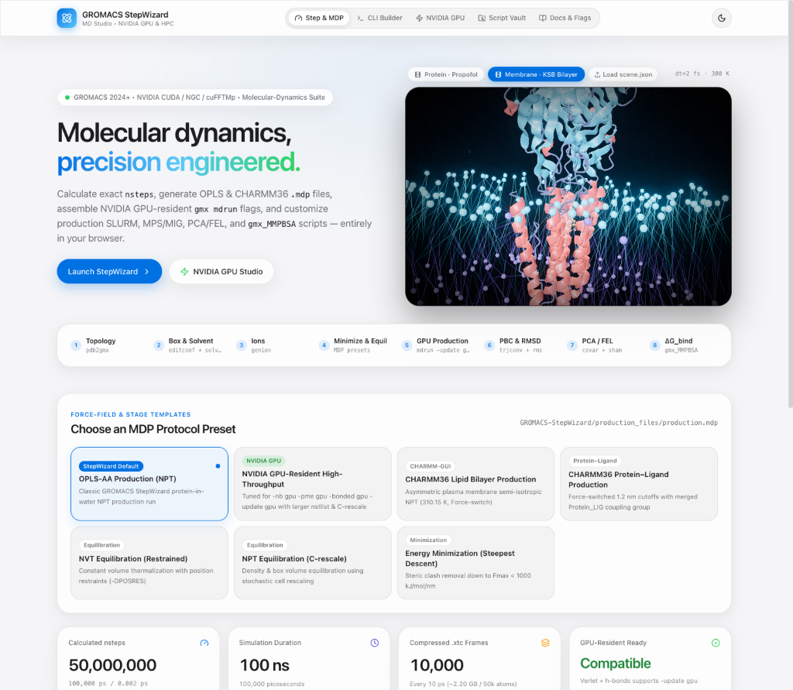

# GROMACS StepWizard 2.0

[](https://react.dev/)
[](https://www.typescriptlang.org/)
[](https://www.framer.com/motion/)
[](https://catalog.ngc.nvidia.com/orgs/hpc/containers/gromacs)
[](LICENSE.txt)

**Molecular dynamics, precision engineered.**

**GROMACS StepWizard 2.0** is an Apple-crafted, pure client-side frontend studio for **GROMACS** molecular dynamics researchers. Calculate exact `nsteps`, generate OPLS-AA & CHARMM36 `.mdp` files, assemble official GROMACS & NVIDIA GPU-accelerated CLI commands, customize production HPC/SLURM and analysis scripts from [`Molecular-Dynamics`](https://github.com/pritampanda15/Molecular-Dynamics), and preview real MD trajectory movies directly in the browser — with zero backend required.



> **Video Walkthrough (v1):** [YouTube Tutorial](https://www.youtube.com/watch?v=RWzqH28UeLE)

---

## Core Workspaces & Capabilities

### 1. Real MD Trajectory Movie Player (Hero Stage)
- Smooth Apple-styled HTML5 video showcase featuring pre-rendered GROMACS MD trajectory clips:
  - **Membrane · Lipid Bilayer** — Transmembrane protein embedded in a lipid bilayer (`CHARMM36` semi-isotropic NPT, 310.15 K).
  - **Protein · Ligand Complex** — Explicit-solvent protein–ligand binding dynamics.
- **Load Local Video**: Preview your own `.mp4` / `.webm` MD movies exported from PyMOL, VMD, ChimeraX, or GROMACS with playback speed controls (`0.5×`–`2×`), timeline scrubbing, and fullscreen mode.

### 2. Step & MDP Wizard
- Instant `nsteps` calculator across **picoseconds (`ps`)**, **nanoseconds (`ns`)**, and **microseconds (`µs`)** with selectable integration timestep (`1 fs`, `2 fs`, `4 fs HMR`), temperature, thermostat (`V-rescale`, `Nose-Hoover`, `berendsen`), barostat (`Parrinello-Rahman`, `C-rescale`), `constraints`, `nstlist`, and `.xtc` save cadence.
- **7 Curated `.mdp` Presets**:
  - OPLS-AA Production (NPT)
  - NVIDIA GPU-Resident High-Throughput (`nstlist = 100`, `C-rescale`, `h-bonds`)
  - CHARMM36 Asymmetric Lipid Bilayer Production (`step7_production.mdp`, `semiisotropic`, `Force-switch`, 310.15 K)
  - CHARMM36 Protein–Ligand Production (`Protein_LIG` coupling)
  - NVT Equilibration (Restrained `-DPOSRES`)
  - NPT Equilibration (`C-rescale`, `refcoord_scaling = com`)
  - Energy Minimization (Steepest Descent, `step6.0_minimization.mdp`)
- Live GPU-resident compatibility check (`Verlet` + `h-bonds`), estimated `.xtc` frame count & trajectory size, syntax-highlighted `.mdp` download, and companion `gmx grompp` / `gmx mdrun` commands.

### 3. Visual GROMACS CLI Builder
- Toggle between **`gmx` (Thread-MPI)** and **`gmx_mpi` (HPC MPI)** and interactively assemble validated commands across the full MD lifecycle:
  - **`mdrun`**: `-ntmpi`, `-ntomp`, `-npme`, `-nb`, `-pme`, `-bonded`, `-update`, `-nstlist`, `-pin`, `-pinoffset`, `-dlb`, `-tunepme`, `-maxh`, `-cpi`, `-append`
  - **`grompp`**: `-f`, `-c`, `-r`, `-t`, `-p`, `-n`, `-o`, `-maxwarn`
  - **System Setup**: `pdb2gmx`, `editconf`, `solvate`, `genion`
  - **Post-Processing**: `trjconv` (`-center -pbc mol -ur compact`, `-fit rot+trans`, `-sep -skip`), `rms` (`-tu ns`)
  - **Extend Run**: `convert-tpr -extend` + checkpoint restart
  - **PCA & Free Energy Landscape**: `covar`, `anaeig` (`-2d`, `-extr`, `-entropy`), `sham`, `xpm2ps`
  - **Binding Free Energy**: `gmx_MMPBSA` & `gmx_MMPBSA_ana`

### 4. NVIDIA GPU & HPC Acceleration Studio
- **Interactive Host CPU ↔ NVIDIA GPU Offload Diagram**: Click any task tile (`Non-Bonded`, `PME Long-Range`, `Bonded Forces`, `Update & LINCS`) to animate task placement between CPU and GPU and observe PCIe vs. GPU-resident loop behavior.
- Ready-to-run launch generators built from official **NVIDIA GROMACS Docs** and `Molecular-Dynamics/hpc/nvidia-gpu/`:
  - **Single-GPU Resident** (`-nb gpu -pme gpu -bonded gpu -update gpu`, `GMX_CUDA_GRAPH=1`, `-nstlist 100`)
  - **Multi-GPU Direct Comm** (`GMX_ENABLE_DIRECT_GPU_COMM=1`, `-npme 1`, optional GROMACS 2020–2021 legacy env vars)
  - **Multi-Node `cuFFTMp` PME Decomposition** (`GMX_GPU_PME_DECOMPOSITION=1`, CMake `-DGMX_USE_CUFFTMP=ON`)
  - **NVIDIA NGC Containers** (`docker run --gpus` & rootless `singularity`/`apptainer run --nv` with `nvcr.io/hpc/gromacs`)
  - **NVIDIA CUDA MPS** (`nvidia-cuda-mps-control -d`, `-multidir` & independent `-pinoffset`)
  - **A100 / H100 MIG Partitioning** (`nvidia-smi mig -cgi`, `CUDA_VISIBLE_DEVICES=MIG-<uuid>`)

### 5. Molecular-Dynamics Script Vault
- Searchable, category-filtered library of live-parameterized scripts from [`Molecular-Dynamics`](https://github.com/pritampanda15/Molecular-Dynamics) — edit cluster accounts, node counts, OpenMP threads, prefixes, or GB parameters live and export `.sh`, `.csh`, or `.in` files:
  - `run_ngc_gromacs.sh` · `run_mps_multidir.sh` · `run_protein_md.sh` · `slurm_protein_md.sh` · `run_lipid_bilayer_slurm.sh` · `slurm_charmm_gui.csh` · `batch_postprocess.sh` · `run_pca_fel_windows.sh` · `mmpbsa.in` · `protein_ligand_cgenff.sh`

### 6. Unified Docs & Flags Reference
- Instant Spotlight search across 40+ GROMACS official CLI flags, NVIDIA GPU environment variables/container/MPS/MIG commands, and `.mdp` options, with one-click copyable examples and source badges.

---

## Quick Start

### Prerequisites
- **Node.js** 18+ (tested with Node 22) and `npm`

### Run Locally
```bash
git clone https://github.com/pritampanda15/GROMACS-StepWizard.git
cd GROMACS-StepWizard
npm install
npm run dev
```
Open `http://localhost:5173/` in your browser.

### Build for Production
```bash
npm run build
npm run preview
```
The static production output in `dist/` can be deployed directly to **Vercel**, **Netlify**, **Cloudflare Pages**, or **GitHub Pages** with zero server configuration.

---

## Project Structure

```text
GROMACS-StepWizard/
├── index.html                        # Vite entry HTML
├── package.json                      # React 19, TypeScript, Vite, Tailwind v4, Framer Motion
├── vite.config.ts                    # Vite build config
├── public/
│   └── media/
│       ├── membrane_bilayer_md.mp4   # Pre-rendered membrane protein + lipid bilayer MD clip
│       └── protein_ligand_md.mp4     # Pre-rendered protein-ligand MD clip
├── src/
│   ├── App.tsx                       # Adaptive Light/Dark shell, nav, hero & 8-stage MD pipeline
│   ├── index.css                     # Apple design tokens & frosted glass styles
│   ├── components/
│   │   ├── ApplePrimitives.tsx       # SegmentedControl, AppleSwitch, AnimatedNumber, CodeShowcase
│   │   ├── MdMoviePlayer.tsx         # Apple-styled HTML5 MD trajectory movie player
│   │   ├── StepWizardSection.tsx     # Step calculator & MDP generator
│   │   ├── CommandBuilderSection.tsx # Visual GROMACS CLI assembler
│   │   ├── GpuOffloadDiagram.tsx     # Interactive CPU <-> NVIDIA GPU offload motion graphic
│   │   ├── NvidiaGpuStudio.tsx       # Single/Multi-GPU, cuFFTMp, NGC, MPS & MIG studio
│   │   ├── ScriptVaultSection.tsx    # Live-parameterized Molecular-Dynamics script vault
│   │   └── ReferenceSection.tsx      # Spotlight-searchable CLI, GPU & MDP reference
│   └── data/
│       ├── mdpPresets.ts             # 7 curated MDP templates & parameter docs
│       ├── cliReference.ts           # GROMACS + NVIDIA GPU CLI & env var catalog
│       └── scriptsVault.ts           # Parameterized scripts from Molecular-Dynamics
├── images/
│   └── stepwizard_v2_hero.png        # v2 frontend showcase screenshot
├── app.py                            # Legacy Flask app (preserved)
└── mdp-generator-app.py              # Legacy Streamlit app (preserved)
```

---

## Tech Stack

- **Framework**: React 19 + TypeScript + Vite 6
- **Styling**: Tailwind CSS v4 + Apple HIG Light/Dark translucent design tokens
- **Motion Graphics**: Framer Motion spring physics + interactive SVG/CSS GPU pipeline animations
- **Icons**: Lucide React

---

## Legacy Python / Streamlit Versions

The original v1 Flask ([`app.py`](app.py)) and Streamlit ([`mdp-generator-app.py`](mdp-generator-app.py)) apps remain preserved in this repository:
- Legacy Streamlit Deployment: https://gromacs-stepwizard-mlxl5hetcpbozrlc94gtyu.streamlit.app/
- Run legacy Flask locally: `pip install -r requirements.txt && python app.py`

---

## Author

**Pritam Kumar Panda**  
Stanford University  
[GitHub](https://github.com/pritampanda15) | [LinkedIn](https://www.linkedin.com/in/pritam-kumar-panda/)

---

## License

This project is licensed under the **Apache License 2.0**. See [`LICENSE.txt`](LICENSE.txt) for details.
