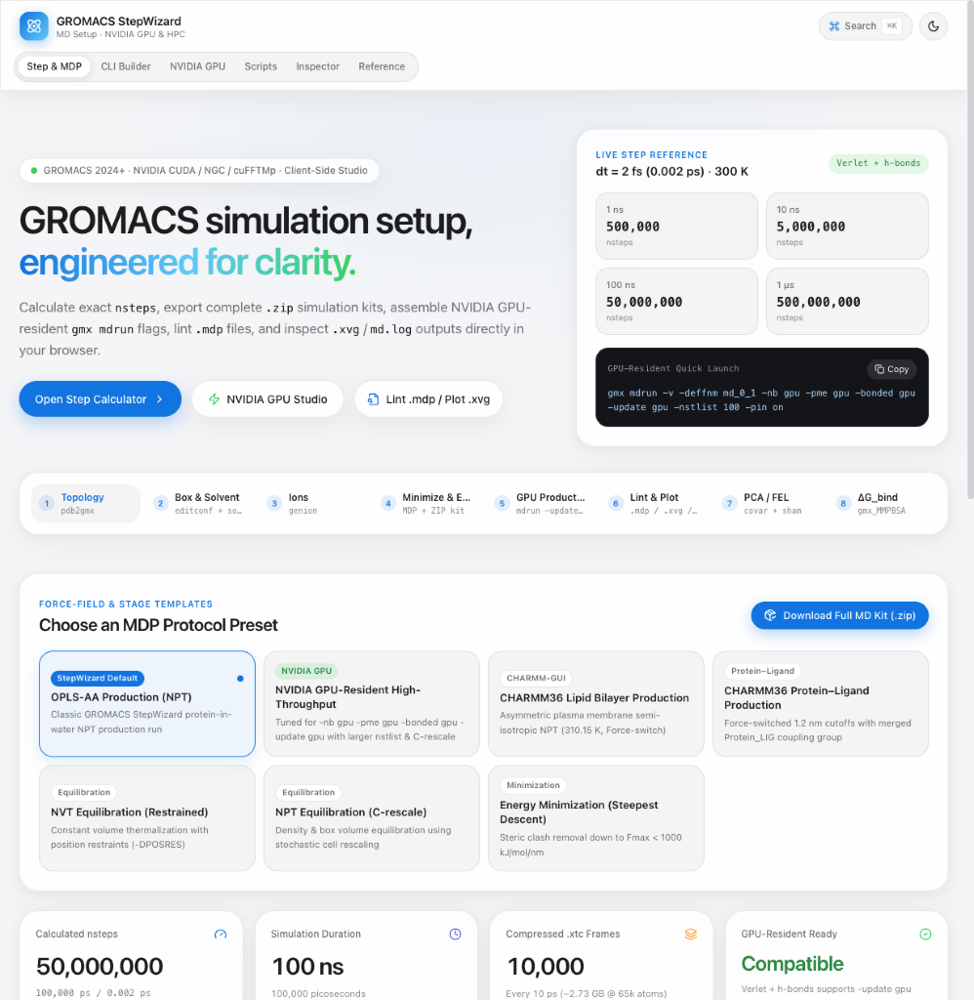

# GROMACS StepWizard

[](https://pritampanda15.github.io/GROMACS-StepWizard/)
[](https://github.com/pritampanda15/GROMACS-StepWizard/actions/workflows/ci.yml)
[](https://github.com/pritampanda15/GROMACS-StepWizard/actions/workflows/deploy.yml)
[](LICENSE)

**Live Application:** [https://pritampanda15.github.io/GROMACS-StepWizard/](https://pritampanda15.github.io/GROMACS-StepWizard/)

**GROMACS StepWizard** is a client-side web studio for **GROMACS** molecular dynamics workflows. Calculate exact `nsteps`, export complete `.mdp` and shell script simulation kits (`.zip`), build GROMACS & NVIDIA GPU-accelerated CLI commands, estimate HPC walltime and `.xtc` storage, lint `.mdp` files, and inspect `.xvg` and `md.log` outputs — all directly in the browser with no backend required.



---

## Features

| Workspace | Capabilities |
| :--- | :--- |
| **Step & MDP Wizard** | Convert simulation length (`ps`, `ns`, `µs`) to exact `nsteps` across `1 fs`, `2 fs`, `4 fs HMR`, and `20 fs Martini CG` timesteps; **13 curated `.mdp` presets** (OPLS-AA, NVIDIA GPU-Resident, CHARMM36 Lipid Bilayer, CHARMM36 Protein–Ligand, Steered MD `md_pull.mdp`, Umbrella Sampling `md_umbrella.mdp`, Alchemical FEP/ABFE `fep_lambda.mdp`, AWH Adaptive PMF `awh_md.mdp`, Coarse-Grained Martini 3 `martini3_prod.mdp`, 4 fs HMR `production_hmr_4fs.mdp`, NVT, NPT, Energy Minimization); **Share Setup URL** links; one-click **Full MD Kit (`.zip`)** export; and an **HPC Walltime, SLURM `-maxh` & Storage Estimator**. |
| **CLI Builder** | Visual `gmx` / `gmx_mpi` command assembler covering `mdrun`, `grompp`, system setup (`pdb2gmx`, `editconf`, `solvate`, `genion`), PBC & RMSD (`trjconv`, `rms`), **Analysis Suite** (`rmsf`, `gyrate`, `hbond`, `sasa`, `mindist -pi`, `dssp`, `energy`), run extension (`convert-tpr`), PCA/FEL (`covar`, `anaeig`, `sham`, `xpm2ps`), **Umbrella / WHAM**, **FEP / BAR & MBAR**, **Multi-Walker AWH**, **T-REMD** (with live geometric temperature ladder calculator), **PLUMED Well-Tempered Metadynamics**, and `gmx_MMPBSA`. |
| **NVIDIA GPU Studio** | Interactive **Host CPU ↔ NVIDIA GPU** task offload visualizer (`-nb`, `-pme`, `-bonded`, `-update`) and launch generators for Single-GPU Resident (`GMX_CUDA_GRAPH=1`), Multi-GPU Direct Comm (`GMX_ENABLE_DIRECT_GPU_COMM=1`), Multi-Node `cuFFTMp` PME Decomposition (`GMX_GPU_PME_DECOMPOSITION=1`), NVIDIA NGC Containers (Docker & Singularity/Apptainer), CUDA MPS (`-multidir` & `-pinoffset`), and A100/H100 MIG partitioning. |
| **Script Vault** | 18 live-parameterized bash, C-shell, PLUMED, and `gmx_MMPBSA` scripts covering [`Molecular-Dynamics`](https://github.com/pritampanda15/Molecular-Dynamics), NVIDIA GPU/MPS, SLURM arrays (`slurm_fep_array.sh`, `slurm_umbrella_array.sh`), AWH (`run_awh_multiwalker.sh`), T-REMD (`run_tremd_multidir.sh`), Martini 3 CG (`run_martini3_cg.sh`), PLUMED WT-MetaD (`plumed_wtmetad.dat`), and 4 fs HMR (`prepare_hmr_4fs.sh`). |
| **Inspector** | Client-side **`.mdp` Sanity Linter** (10 ensemble & GPU rules with one-click auto-fix), interactive **`.xvg` Plotter & `md.log` Benchmark Parser**, **GROMACS Crash & Error Troubleshooter**, and **Box Volume & Salt/Ion Calculator** (`gmx genion`). |
| **Docs & Flags + `⌘K` Search** | Instant `⌘K` / `Ctrl+K` command palette and searchable reference across GROMACS official CLI arguments, NVIDIA GPU environment variables, and `.mdp` options. |

---

## Quick Start

### Prerequisites
- **Node.js** 18+ (22 recommended) and `npm`

### Local Development
```bash
git clone https://github.com/pritampanda15/GROMACS-StepWizard.git
cd GROMACS-StepWizard
npm install
npm run dev
```
Open `http://localhost:5173/` in your browser.

### Typecheck & Production Build
```bash
npm run typecheck
npm run build
npm run preview
```

Pushes to `main` are checked by [`.github/workflows/ci.yml`](.github/workflows/ci.yml) and automatically deployed to GitHub Pages via [`.github/workflows/deploy.yml`](.github/workflows/deploy.yml).

---

## Repository Structure

```text
GROMACS-StepWizard/
├── .github/
│   ├── ISSUE_TEMPLATE/
│   │   ├── bug_report.md
│   │   └── feature_request.md
│   └── workflows/
│       ├── ci.yml                      # TypeScript & Vite build verification
│       └── deploy.yml                  # GitHub Pages deployment
├── docs/
│   └── screenshot.png                  # Application preview
├── public/
│   └── media/                          # Bundled MD trajectory clips
├── src/
│   ├── App.tsx                         # Application shell, navigation & 8-stage MD pipeline
│   ├── main.tsx                        # React entry point
│   ├── index.css                       # Light/Dark theme tokens & styling
│   ├── components/
│   │   ├── UiPrimitives.tsx            # SegmentedControl, ToggleSwitch, AnimatedNumber, CodeShowcase
│   │   ├── MdMoviePlayer.tsx           # Trajectory video previewer
│   │   ├── StepWizardSection.tsx       # Step calculator, MDP generator, ZIP export & walltime planner
│   │   ├── CommandBuilderSection.tsx   # Visual GROMACS CLI builder
│   │   ├── GpuOffloadDiagram.tsx       # Interactive CPU <-> NVIDIA GPU offload diagram
│   │   ├── NvidiaGpuStudio.tsx         # Single/Multi-GPU, cuFFTMp, NGC, MPS & MIG studio
│   │   ├── ScriptVaultSection.tsx      # Parameterized Molecular-Dynamics script library
│   │   ├── AnalyzerSection.tsx         # Client-side .mdp linter & .xvg / md.log analyzer
│   │   ├── ReferenceSection.tsx        # Searchable CLI, NVIDIA GPU & MDP documentation
│   │   └── SpotlightPalette.tsx        # Cmd+K / Ctrl+K quick search palette
│   ├── data/
│   │   ├── mdpPresets.ts               # Curated MDP templates & parameter docs
│   │   ├── cliReference.ts             # GROMACS & NVIDIA GPU CLI flag catalog
│   │   └── scriptsVault.ts             # Parameterized HPC & analysis scripts
│   └── utils/
│       └── simulationKit.ts            # Client-side .zip simulation bundle generator
├── index.html
├── package.json
├── tsconfig.json
├── vite.config.ts
├── CONTRIBUTING.md
└── LICENSE
```

---

## Tech Stack

- **UI & Build**: React 19, TypeScript 5.7, Vite 6, Tailwind CSS v4
- **Animation & Icons**: Framer Motion, Lucide React
- **Bundle Export**: JSZip

---

## Contributing

Contributions are welcome! See [`CONTRIBUTING.md`](CONTRIBUTING.md) for local setup and pull request guidelines.

---

## Author & License

**Pritam Kumar Panda** · Stanford University  
[GitHub](https://github.com/pritampanda15) · [LinkedIn](https://www.linkedin.com/in/pritam-kumar-panda/) · [Molecular-Dynamics Repository](https://github.com/pritampanda15/Molecular-Dynamics)

Licensed under the **Apache License 2.0** — see [`LICENSE`](LICENSE) for details.
